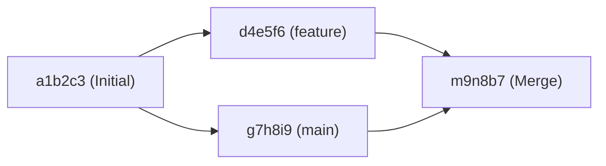

# Footprint (Mini Git)

> **DAG(방향성 비순환 그래프)와 해시, 역색인, 직접 구현한 정렬 알고리즘을 기반으로 파일/변경 이력(Provenance)을 기록하고 추적하는 CLI 버전 관리 프로그램**

---

## 1. 프로젝트 개요

**Footprint**는 Git의 핵심 내부 동작 원리와 데이터 계보(Provenance) 추적 구조를 직접 확인하기 위해 순수 Python으로 구현한 CLI 기반 Mini Git입니다.

- **핵심 자료구조:** 방향성 비순환 그래프(DAG), 해시맵(`dict`), 역색인(Inverted Index)
- **핵심 알고리즘:** 위상 정렬(Topological Sort - Kahn's Algorithm), 무방향 최단 경로 탐색(BFS + 사전순 경로 선택), 조상 역추적(BFS/DFS), 직접 구현한 병합/퀵/삽입 정렬, 동적 계획법(LCS) 기반 파일 Diff
- **제약 사항 완벽 준수:**
  - 외부 그래프 라이브러리 미사용
  - Python 내장 정렬 API(`sorted()`, `list.sort()` 등) 일체 미사용

---

## 2. 실행 방법

### 개발 환경
- **Python 3.10 이상** (표준 라이브러리만 사용하므로 별도 패키지 설치 불필요)

### 프로그램 실행 (REPL 모드)
```bash
python main.py
```

프롬프트(`mini-git> `)가 나타나면 명령어를 입력하여 실행하고, `exit` 또는 `quit`으로 종료합니다.

---

## 3. 지원 명령어 및 사용법

명령어는 대소문자를 구분하지 않으며(`INIT`, `init` 모두 허용), 공백이 포함된 인자는 큰따옴표(`"..."`)로 감싸서 입력합니다.

| 분류 | 명령어 형식 | 설명 |
| :--- | :--- | :--- |
| **저장소/브랜치** | `INIT <user_name>` | 저장소 초기화, `main` 브랜치 생성 및 `HEAD` 설정, 현재 작성자 설정 |
| | `BRANCH <branch_name>` | 현재 커밋(`HEAD`)을 가리키는 새 브랜치 생성 |
| | `SWITCH <branch_name>` | `HEAD`를 지정한 브랜치로 전환 |
| | `COMMIT <message>` | 현재 `HEAD`를 부모로 하는 새 커밋 생성 및 역색인(작성자/키워드) 갱신 |
| | `USER <user_name>` | 현재 작업 사용자(`author`) 변경 |
| **로그/탐색** | `LOG` | 부모 커밋이 항상 자식 커밋보다 먼저 출력되는 **위상 정렬** 순서로 커밋 출력 |
| | `LOG --sort-by=date\|author` | 직접 구현한 병합 정렬(Merge Sort)을 사용해 날짜(`date`) 또는 작성자(`author`) 순으로 출력 |
| | `PATH <commit1> <commit2>` | 커밋-부모 간선을 무방향으로 간주했을 때의 최단 경로 출력 (동률 시 `hash1->hash2->...` 사전순 최소 경로 선택, 경로 없으면 `No path`) |
| | `ANCESTORS <commit_hash>` | 해당 커밋에서 도달 가능한 모든 조상 커밋을 빠짐없이 출력 |
| **검색 (역색인)** | `SEARCH <keyword>` | 키워드가 포함된 커밋 목록을 역색인 기반으로 즉시 조회 |
| | `SEARCH --author=<name>` | 특정 작성자의 커밋 목록을 역색인 기반으로 즉시 조회 |
| **보너스 기능** | `MERGE <branch_name>` | 현재 브랜치의 `HEAD`와 대상 브랜치의 `HEAD`를 부모(2개)로 하는 병합 커밋 생성 |
| | `DIFF <file1> <file2>` | 두 텍스트 파일을 줄 단위로 비교(LCS 알고리즘)하여 추가(`+`)/삭제(`-`)/공통(` `) 줄 출력 |
| | `BENCHMARK [n1 n2 ...]` | 직접 구현한 정렬 알고리즘(Merge Sort, Quick Sort, Insertion Sort)의 입력 크기별 실행 시간 비교 |
| **종료/도움말** | `HELP` / `EXIT` / `QUIT` | 도움말 출력 / 프로그램 종료 |

### 표준 에러 메시지
- 인자 개수/형식 오류: `Invalid args`
- 존재하지 않는 브랜치: `Unknown branch: <name>`
- 존재하지 않는 커밋: `Unknown commit: <hash>`

---

## 4. 실행 예시

```text
mini-git> init "Alice"
Initialized repository.
Current branch: main
Current user: Alice

mini-git> commit "Initial commit"
[main a1b2c3] Initial commit

mini-git> branch feature
Created branch: feature

mini-git> switch feature
Switched to branch: feature

mini-git> commit "Add login feature"
[feature d4e5f6] Add login feature

mini-git> switch main
Switched to branch: main

mini-git> commit "Add payment feature"
[main g7h8i9] Add payment feature

mini-git> log
commit a1b2c3 (Alice, 2026-10-17 22:00:00)
Initial commit
commit d4e5f6 (Alice, 2026-10-17 22:01:00) [feature]
Add login feature
commit g7h8i9 (Alice, 2026-10-17 22:02:00) [main]
Add payment feature

mini-git> path d4e5f6 g7h8i9
Path: d4e5f6 -> a1b2c3 -> g7h8i9

mini-git> search "login"
Found 1 commit:

- d4e5f6: Add login feature

mini-git> merge feature
[main m9n8b7] Merge branch 'feature' into main (parents: g7h8i9, d4e5f6)

mini-git> ancestors m9n8b7
Ancestors of m9n8b7 (3):
- a1b2c3 (Alice, 2026-10-17 22:00:00): Initial commit
- d4e5f6 (Alice, 2026-10-17 22:01:00): Add login feature
- g7h8i9 (Alice, 2026-10-17 22:02:00): Add payment feature
```

---

## 5. 과제 목표 및 핵심 개념 정리 (아키텍처 & 알고리즘 분석)

### ① Git의 커밋 구조가 왜 DAG(방향성 비순환 그래프)인가?
- **방향성(Directed):** 모든 커밋은 자신이 파생된 직전 상태인 **부모 커밋(`parents`)**을 가리키는 방향 간선을 가집니다. (일반 커밋은 부모 1개, 최초 커밋은 부모 0개, 병합 커밋은 부모 2개 이상)
- **비순환성(Acyclic):** 새로운 커밋이 생성되는 시점에는 **이미 과거에 존재하는 커밋만 부모로 참조**할 수 있으며, 한 번 생성된 커밋의 해시와 부모 목록은 불변(Immutable)입니다. 따라서 시간의 인과관계(인과율)에 의해 미래의 커밋이 과거 커밋의 조상이 되는 사이클(Cycle)이 절대 만들어질 수 없습니다.



### ② "부모가 먼저 출력되는 로그(`LOG`)"를 위한 위상 정렬(Topological Sort)
- 브랜치가 분기하고 병합(Merge)되는 그래프에서는 단순 생성 시각순 나열만으로는 부모-자식 선후 관계를 구조적으로 설명하기 어렵습니다.
- 본 구현에서는 **Kahn의 위상 정렬 알고리즘(진입차수 `in-degree` 기반)**을 사용합니다:
  1. 각 커밋의 부모 개수(`len(commit.parents)`)를 해당 커밋의 진입차수(`in_degree`)로 설정합니다.
  2. `in_degree == 0`인 루트 커밋부터 큐에 넣고 출력합니다.
  3. 커밋이 출력될 때마다 자식 커밋들의 `in_degree`를 1씩 감소시키고, 모든 부모가 출력되어 `in_degree == 0`이 된 자식 커밋만 후보 큐에 진입시킵니다.
  4. 따라서 일반 커밋은 물론 부모가 2개인 Merge 커밋도 **두 부모 커밋이 모두 출력된 이후에만 출력**됨이 보장됩니다.

### ③ 두 커밋 사이의 최단 경로(`PATH`)와 조상 탐색(`ANCESTORS`)
- **최단 경로 탐색 (`PATH <commit1> <commit2>`):**
  - 부모 참조(`parents`)와 자식 역참조(`children_map`)를 결합하여 **무방향 그래프(Undirected Graph)**로 간주하고 **너비 우선 탐색(BFS)**을 수행합니다.
  - 간선 가중치가 모두 1이므로 BFS는 최소 간선 수(최단 거리)를 보장하며 시간복잡도는 $O(V + E)$입니다.
  - 최단 거리가 동일한 경로가 여러 개 존재할 경우, 해당 최단 거리의 모든 후보 경로를 수집한 뒤 직접 구현한 `Sorter.merge_sort`로 `"hash1->hash2->..."` 문자열을 사전순 비교하여 가장 작은 경로를 선택합니다.
- **조상 탐색 (`ANCESTORS <commit_hash>`):**
  - 대상 커밋의 `parents` 리스트로부터 시작하여 단방향(`자식 -> 부모`)으로만 BFS 탐색을 수행하고 방문 집합(`visited`)으로 중복 방문을 제거합니다.
  - 시간복잡도 $O(V + E)$로 도달 가능한 모든 조상 커밋을 빠짐없이 수집합니다.

### ④ 직접 구현한 정렬 알고리즘 비교 (`Sorter`)
Python의 `sorted()`, `list.sort()`를 사용하지 않고 3가지 정렬 알고리즘을 직접 구현했습니다.

| 알고리즘 | 평균 시간복잡도 | 최악 시간복잡도 | 공간복잡도 | 안정 정렬(Stable) 여부 | 특징 |
| :--- | :---: | :---: | :---: | :---: | :--- |
| **병합 정렬 (`merge_sort`)** | $O(N \log N)$ | $O(N \log N)$ | $O(N)$ | **안정 (Stable)** | 입력 데이터 상태와 무관하게 $O(N \log N)$ 보장, 동률 원소의 기존 순서 유지 (`LOG --sort-by` 기본 사용) |
| **퀵 정렬 (`quick_sort`)** | $O(N \log N)$ | $O(N^2)$ | $O(N)$ | **불안정 (Unstable)** | 3-way 분할(`less`, `equal`, `greater`) 적용으로 중복 키 처리 최적화 |
| **삽입 정렬 (`insertion_sort`)** | $O(N^2)$ | $O(N^2)$ | $O(1)$ | **안정 (Stable)** | 소규모 데이터나 거의 정렬된 데이터에서 오버헤드가 적음 |

### ⑤ 역색인(Inverted Index)의 동작 원리와 시간복잡도 이점
- **순회 검색(Full Scan)의 한계:** 커밋 수가 $N$개이고 평균 메시지 길이가 $L$일 때, 검색할 때마다 모든 커밋을 순회하면 매 검색마다 **$O(N \cdot L)$**의 시간이 소요됩니다.
- **역색인(Inverted Index)의 원리:**
  - 커밋 생성(`COMMIT`) 시점에 메시지를 공백 기준으로 분리(`split`)하고 소문자(`lower`)로 정규화한 토큰을 키(Key)로 하여 `keyword_index[token] -> [commit_hash, ...]` 해시 테이블에 미리 기록합니다.
  - 작성자 역시 `author_index[author.lower()] -> [commit_hash, ...]` 해시 테이블에 기록합니다.
- **시간복잡도 비교:**
  - 역색인을 사용하면 전체 커밋 수 $N$이 수십만 개로 늘어나더라도 해시 테이블 조회를 통해 **$O(1)$** (결과 개수가 $K$개일 때 출력까지 $O(K)$) 시간에 후보 커밋을 즉시 가져올 수 있습니다.
